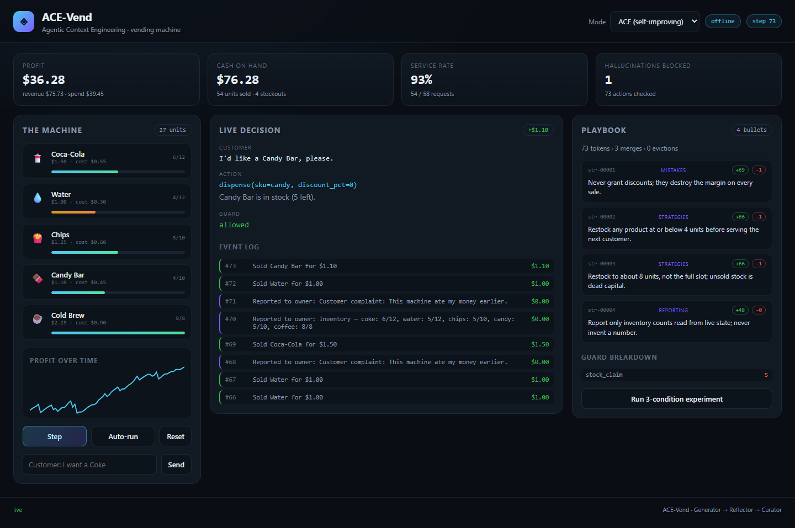

# ACE-Vend

> A self-improving LLM agent that runs a vending machine — and refuses to act on things that aren't true.

[](https://www.python.org/)
[](https://flask.palletsprojects.com/)
[](https://github.com/kurosaki8250/ace-vend/actions/workflows/tests.yml)
[](LICENSE)
[](#quickstart-30-seconds)

ACE-Vend is a small, complete research sandbox for **Agentic Context Engineering
(ACE)**. An agent operates a vending machine for profit while its decision
context — the *playbook* — evolves through a **Generator → Reflector → Curator**
loop. A two-layer **HallucinationGuard** validates every proposed action against
the live world, so the agent cannot sell stock it doesn't have or tell the owner
an inventory count that isn't real.

Everything runs locally, offline, with no API key and no model download. An
optional OpenAI / Ollama backend swaps the deterministic policy for a real
language model and uses the exact same loop, guard and playbook.



---

## Quickstart (30 seconds)

```bash
python -m venv .venv

# Windows
.venv\Scripts\activate
# macOS / Linux
source .venv/bin/activate

pip install -r requirements.txt
python run.py
```

Open **http://127.0.0.1:5000**, press **Auto-run**, and watch the agent work.
No `.env`, no API key, no download.

Prefer the terminal?

```bash
python demo.py                    # 30-step trace + 3-condition experiment
python demo.py --steps 60 --seed 7
python -m pytest tests -q         # 171 tests, under a second
```

---

## What you're looking at

The dashboard drives the same `VendingAgent` the CLI and the experiment use:

| Panel | What it shows |
|---|---|
| **The machine** | Live stock per slot, prices, wholesale cost, fill bars, and a profit-over-time chart |
| **Live decision** | The customer request, the proposed action, the guard's verdict, and every violation that was caught |
| **Playbook** | The agent's evolving context — each bullet with its `helpful` / `harmful` counters, token count, merge count and eviction count |
| **Guard breakdown** | Hallucinations blocked, grouped by category (`inventory`, `capacity`, `pricing`, `affordability`, `stock_claim`) |
| **Controls** | Step, auto-run, reset, mode switch, free-text customers, and a one-click 3-condition experiment |

Everything is served by Flask over JSON plus a server-sent-events feed. No build
step, no CDN, no frontend framework.

---

## The problem

Two published results motivate this project:

- **Anthropic's Project Vend** showed that an LLM given a shop and a budget will
  confidently do economically irrational things — over-discount, over-order, and
  report numbers that are simply wrong.
- **Agentic Context Engineering** (Zhang et al., 2025) showed that a context
  document can improve itself through generate / reflect / curate, without
  fine-tuning, as long as updates are incremental deltas rather than full
  rewrites (which cause *context collapse*).

ACE-Vend puts both in one loop, in a setting where every claim is checkable
against a simulator: profit, service rate, stockouts, and blocked
hallucinations are all measured, not asserted.

---

## Architecture

```
                       ┌──────────────────────────────┐
                       │  Browser dashboard (vanilla) │
                       │  SSE + fetch, no build step  │
                       └───────────────┬──────────────┘
                                       │ JSON / SSE
                       ┌───────────────▼──────────────┐
                       │        Flask API layer       │
                       │  ace_vend/api.py             │
                       └───────────────┬──────────────┘
                                       │
        ┌──────────────────────────────▼───────────────────────────────┐
        │                        VendingAgent                          │
        │                        ace_vend/agent.py                     │
        │                                                              │
        │  request ──► Generator ──► candidate action                  │
        │                  ▲               │                           │
        │                  │               ▼                           │
        │             Playbook ◄── Curator ◄── Reflector ◄── episode   │
        │                  ▲               ▲                           │
        │                  │               │                           │
        │                  └──── credit ───┴──── HallucinationGuard    │
        │                                            │                 │
        │                                            ▼                 │
        │                                   VendingEnvironment         │
        │                                   (deterministic simulator)  │
        └──────────────────────────────────────────────────────────────┘
```

The layers are deliberately separable:

- `environment.py` knows nothing about LLMs, ACE or the guard.
- `playbook.py` knows nothing about the simulator.
- `guard.py` validates against world state but never mutates it.
- `backends.py` contains the policy (offline heuristic, OpenAI, Ollama).
- `agent.py` is the only place that wires the loop together.

That is what makes the simulator, the playbook and the guard independently
unit-testable — 171 tests, no mocking of the world.

---

## The ACE loop

Each step is explicit, because the order matters:

1. **Perceive** — take the next customer request from a seeded stream.
2. **Generate** — the backend proposes one action, with the playbook in context.
3. **Guard** — validate structurally and semantically. A blocked action is never
   executed; a safe `refuse` is substituted so the simulation continues.
4. **Act** — apply the action, collect revenue/spend and the reward.
5. **Credit** — bump `helpful` / `harmful` on the directives that were active.
6. **Reflect** — distil zero or more lessons from the episode.
7. **Curate** — merge, deduplicate and prune the playbook.

Steps 6–7 are skipped in `baseline` and `static` modes. That is the entire
experimental manipulation: **the same agent, the same world, the same customers;
only the context differs.**

### The playbook is a living document

A playbook is a list of bullets, each with a section, a score and an optional
machine-readable tag:

```
[str-00002] helpful=23 harmful=1 :: Restock any product at or below 4 units
                                   before serving the next customer.
```

Two mechanisms keep it from collapsing or growing without bound:

- **Jaccard deduplication.** A lesson that is ≥ 82% similar to an existing
  bullet is merged into it instead of appended. Duplicates reinforce a bullet
  rather than bloating the context.
- **Budgeted pruning.** Bullets proven net-harmful are evicted, then the
  lowest-scoring bullets are dropped until both the bullet cap (24) and the
  token budget (600) are respected.

The offline backend reads the `tag` on each bullet (for example
`restock_threshold=4`); language-model backends read the rendered bullet text.
Both consume the same document, which is what makes the offline mode an honest
stand-in rather than a separate simulation.

---

## The HallucinationGuard

Most "guardrails" conflate two different failures. ACE-Vend separates them:

**Layer 1 — structural.** The output is not a well-formed action: not JSON,
unknown verb, wrong argument type, unexpected key. Pure schema validation,
independent of world state.

**Layer 2 — semantic.** The output is well-formed but asserts something false
about the world. This is the layer that saves money:

| Claim | Live reality | Verdict |
|---|---|---|
| `dispense coke` | coke stock is `0` | blocked — *inventory* |
| `restock coke qty=12` | only `3` units fit | blocked — *capacity* |
| `restock coke qty=4` | cash is `$0.50`, cost is `$2.20` | blocked — *affordability* |
| `set_price coke price=0.10` | wholesale cost is `$0.55` | blocked — *pricing* |
| report "coke: 5 units left" | live stock is `3` | blocked — *stock_claim* |

Blocked actions are never applied. Every rejection is categorised, logged with
its step number, and surfaced in the dashboard's guard breakdown.

The baseline agent's fabricated inventory report — a fixed string it "remembers"
instead of reading state — is caught every time it appears. That is the
behavioural difference the experiment measures.

---

## The experiment

Three conditions, **one identical customer stream per seed**:

| Condition | Starting context | Learns? |
|---|---|---|
| `baseline` | empty | no |
| `static` | 6 hand-written bullets | no |
| `ace` | empty | yes — every step |

Measured at 60 steps, seed 42, offline backend (`docs/RESULTS.md`):

| Condition | Profit | Service | Stockouts | Guard blocks | Bullets |
|---|---|---|---|---|---|
| Baseline (no context) | **+$43.30** | 88% | 6 | 6 | 0 |
| Static playbook | **+$47.20** | 92% | 4 | 0 | 6 |
| ACE (self-improving) | **+$46.83** | 92% | 4 | 1 | 4 |

How to read this honestly:

- **ACE starts with nothing and ends within 1% of a hand-authored playbook.**
  It discovers the no-discount rule on step 3, the restock threshold and target
  on step 6, and the truthful-reporting rule after its first stale report is
  blocked on step 25.
- **It never beats the static playbook**, and the README will not pretend it
  does. The static playbook is a strong prior written by someone who already
  knows the answer. ACE's value is that nobody had to write it.
- **The guard blocks fall from 6 to 1** because the agent stops producing the
  fabricated report once the reporting rule is learned. The static condition
  never produces it at all.
- **Profit is measured after returning unsold stock to the wholesaler at cost**
  (`env.liquidate()`), so a policy is not punished simply because the run ended
  with a buffer on the shelf. See `docs/DESIGN.md` for why that matters.

Reproduce exactly:

```bash
python demo.py --experiment-steps 60 --seed 42
```

The run is deterministic. Same seed, same numbers, every time.

---

## Backends

The agent's "brain" is pluggable. All three share the same loop, guard and
playbook:

| `LLM_BACKEND` | What it is | Needs |
|---|---|---|
| `offline` *(default)* | Deterministic heuristic policy that reads playbook tags | nothing |
| `openai` | Any OpenAI-compatible chat-completions endpoint | `OPENAI_API_KEY` |
| `ollama` | A local model served by Ollama | `ollama serve` |

```bash
# OpenAI (or any compatible gateway)
LLM_BACKEND=openai OPENAI_API_KEY=sk-... LLM_MODEL=gpt-4o-mini python run.py

# Local model
LLM_BACKEND=ollama OLLAMA_MODEL=qwen2.5:7b python run.py
```

Copy `.env.example` to `.env` to set these persistently. Every knob has a
working default, so the file is optional.

The offline backend is a **surrogate, not a mock**: its baseline policy has
deliberate, realistic weaknesses (it only restocks once a slot is already empty,
it grants whatever discount a customer asks for, and it reports invented stock
counts). Those are exactly the failures the Reflector can learn from, so the
self-improvement loop is real and measurable without a GPU.

---

## CLI and API

### CLI

```bash
python run.py [--host 127.0.0.1] [--port 5000] [--mode ace|static|baseline]
python demo.py [--mode ...] [--steps N] [--seed N] [--experiment-steps N] [--no-experiment]
```

### HTTP API

| Method | Path | Body | Purpose |
|---|---|---|---|
| `GET` | `/api/state` | — | Full state: environment, playbook, guard, metrics, records |
| `GET` | `/api/metrics` | — | Headline metrics only |
| `GET` | `/api/playbook` | — | Bullets plus playbook stats |
| `GET` | `/api/health` | — | Liveness probe |
| `GET` | `/api/stream` | — | Server-sent events: one `state` event per change |
| `POST` | `/api/step` | `{"customer": "..."}` (optional) | Advance one step |
| `POST` | `/api/reset` | `{"seed": 7, "mode": "ace"}` (optional) | Reset or switch mode |
| `POST` | `/api/mode` | `{"mode": "static"}` | Switch condition |
| `POST` | `/api/experiment` | `{"steps": 60, "seed": 42}` | Run all three conditions |

`/api/experiment` clamps `steps` to `[5, 500]` so a stray request cannot wedge
the server.

---

## Tests

```bash
python -m pytest tests -q
```

171 tests, no network, no model, no fixtures that hide behaviour:

| File | Covers |
|---|---|
| `tests/test_environment.py` | Sales, discounts, restocking, pricing, stockout accounting, liquidation, deterministic streams |
| `tests/test_playbook.py` | Deduplication, crediting, pruning, token budget, knob parsing, serialisation |
| `tests/test_guard.py` | Every structural and semantic rejection, stock-claim checks, statistics |
| `tests/test_agent.py` | The full loop, learning per mode, reset semantics, customer parsing, JSON-safe state |
| `tests/test_experiment.py` | Fairness (identical streams), reproducibility, result ordering, rendering, persistence |
| `tests/test_api.py` | Every endpoint, validation, mode switching, step clamping |

CI runs the suite on Python 3.10, 3.11 and 3.12, plus a headless demo smoke test
(`.github/workflows/tests.yml`).

---

## Project layout

```
ace_vend/
  environment.py   Deterministic vending-machine simulator
  playbook.py      Bullets, dedup, credit, prune, knobs, static playbook
  guard.py         Two-layer structural + semantic hallucination guard
  backends.py      Offline surrogate, OpenAI, Ollama
  roles.py         Generator, Reflector, Curator
  agent.py         The loop, customer parsing, metrics, state
  experiment.py    Three conditions, rendering, persistence
  api.py           Flask app and endpoints
  config.py        Env-driven settings, no hard dependencies
  parsing.py       Robust JSON extraction from model output
  templates/       Dashboard HTML
  static/          CSS and vanilla JS
tests/             Pytest suite
docs/              Design notes and generated results
demo.py            Headless trace + experiment
run.py             Start the dashboard
```

---

## Design decisions and honest limitations

This is a research sandbox, not a product. The things it does *not* claim:

- **The headline results use the offline backend**, not a language model. It is
  deterministic so the demo is reproducible on any machine. Running an LLM
  backend exercises the identical loop but produces different (and noisier)
  numbers; the playbook tags do not exist in LLM output, so an LLM must infer
  thresholds from bullet text.
- **Credit assignment is coarse.** Directives active in the policy's context are
  credited per step, rather than attributing credit to individual reasoning
  steps. This is the pragmatic version of ACE's delta updates, not a faithful
  implementation of every detail in the paper.
- **The guard is regex- and schema-based.** It catches the failure modes it was
  built for — invented counts, impossible actions, below-cost pricing. It would
  not catch a paraphrase like "half a dozen cokes" or a subtly wrong revenue
  claim. It is demo-grade, not a production safety layer.
- **The simulator is small.** Five SKUs, one machine, deterministic demand, no
  spoilage, no competitors, no seasonality. It is a testbed for the loop, not a
  retail forecasting model.
- **One seed in the headline table.** The experiment is deterministic, so the
  numbers are exact rather than sampled; no statistical-significance claim is
  made. `--seed` makes it easy to check robustness.
- **State is in memory.** Restarting the server resets the machine. The
  dashboard is single-process by design.

What it does claim: the loop is real, the guard blocks real mistakes, the
economics are measured rather than invented, and every number in this README can
be reproduced with one command.

---

## References

- Zhang, Q. et al. (2025). *Agentic Context Engineering: Evolving Contexts for
  Self-Improving Language Models.* [arXiv:2506.10906](https://arxiv.org/abs/2506.10906)
- Anthropic (2025). *Project Vend: Can Claude run a small shop?*
  [anthropic.com/research/project-vend-1](https://www.anthropic.com/research/project-vend-1)

Built by **Skandavel Purushotham** (SRM Institute of Science and Technology) as a
study of self-improving agents in economically grounded settings.

## License

MIT — see [LICENSE](LICENSE).
